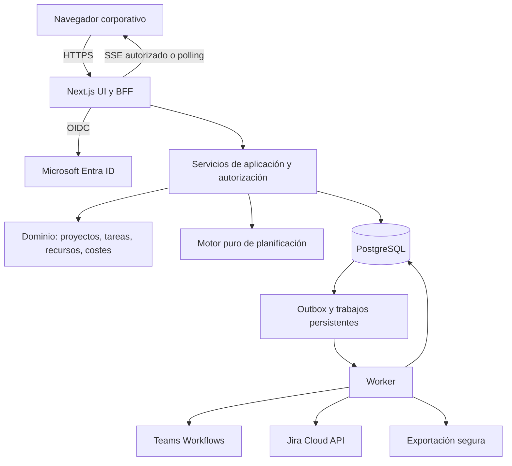

# Arquitectura técnica propuesta

## 1. Diseño
Monolito modular TypeScript en monorepo pnpm workspaces: aplicación Next.js App Router (UI y BFF/API HTTP), paquetes de dominio sin dependencias de infraestructura, PostgreSQL con Drizzle ORM, Zod para contratos, Tailwind/shadcn, TanStack Table, Vitest, Playwright. Un worker separado ejecuta jobs con cola persistente PostgreSQL (evaluar biblioteca compatible y mantenida en F0), no microservicios ni Redis inicialmente. Docker Compose para desarrollo y piloto; producción según infraestructura aprobada. Seleccionar y fijar versiones soportadas, lockfile y licencias en ADR; no se prescribe una versión sin PoC.



## 2. Estructura de repositorio
```text
apps/web/{app,components,server,public}
apps/worker/src/
packages/domain/src/{projects,tasks,resources,time,costs,templates}
packages/scheduling-engine/src/{calendar,graph,schedule,cpm,baseline}
packages/database/{schema,migrations,queries}
packages/contracts/src/
packages/authorization/src/
packages/integrations/src/{jira,teams}
packages/ui/src/
packages/gantt-adapter/src/
tests/{fixtures,integration,e2e,security,performance}
docs/{adr,runbooks,manuals}
infrastructure/{docker,deploy}
.github/workflows/
AGENTS.md
```
Dependencias: UI -> contratos y adaptadores; aplicación -> dominio/motor/puertos; infraestructura implementa puertos; motor no importa React, ORM, HTTP, variables de entorno ni reloj global. Adaptadores no acceden directamente a UI o DB; servicios de aplicación definen transacciones y autorización. Tests de arquitectura impiden imports inversos. No se modifica lógica de planificación dentro de callbacks del componente Gantt.

## 3. Renderizador Gantt: PoC obligatorio
Comparar SVAR React Gantt MIT (`@svar-ui/react-gantt`) y DHTMLX Gantt Community MIT v10+ (integración JS, wrapper React comercial), y considerar render propio solo si ambos fallan. Registrar versión/licencia exacta, compatibilidad comercial interna, teclado, WBS, milestones, drag/resize, tipos de vínculos visuales, zoom/virtualización, overlays de baseline/criticidad, test de 1.000 tareas/2.000 vínculos, adaptación SSR/client-only y coste de mantenimiento. Prohibido usar extensiones PRO sin aprobación de licencia. Selección por matriz ponderada: capacidad funcional 35%, rendimiento 25%, accesibilidad 15%, integración 15%, licencia/mantenimiento 10%. Si ninguno cubre requisitos, elevar ADR: implementar adaptador/render personalizado o adquirir licencia; no recortar silenciosamente.

## 4. Identidad y autorización
Registro web single-tenant Entra por entorno, redirect HTTPS exacto (localhost solo dev), authorization code con PKCE/OIDC y biblioteca soportada, state/nonce, validación firma/iss/aud/exp/tid. Identidad estable `(tid, oid)`; UPN/email solo atributos. Enterprise application assignment required y grupo autorizado/app role `Access` a ratificar; excluir invitados inicialmente mediante política y verificación de aprovisionamiento. Usuario local activo obligatorio. No conceder acceso a un proyecto por dominio de correo. Sesión opaca server-side, cookie Secure HttpOnly SameSite=Lax, expiración y revalidación propuestas de 15 min de identidad/roles, máximo 8 h de sesión; desactivación local inmediata. La revocación Entra depende de la política y de la revalidación; no prometer revocación instantánea remota. MFA/Conditional Access administrados por IT según licencias. Sin contraseñas locales ni bypass de autenticación en producción; mocks solo tests. Consentimiento mínimo (openid/profile y scopes necesarios, Graph no obligatorio para login). Roles globales + membresías y capabilities específicas, comprobación de recurso, campo, acción y proyecto en servicio y consultas. Export/SSE/worker también comprueban autorización vigente. No usar solo middleware ni ocultación UI como autorización.

## 5. API v1 y concurrencia
REST JSON bajo `/api/v1`, OpenAPI generado/revisado, paginación cursor, límites y esquemas validados. Códigos 400 formato, 401 no autenticado, 403 acción prohibida, 404 recurso inaccesible/inexistente según política, 409 revisión/conflicto, 422 regla de dominio, 429 rate limit. Error: `{code,message,fieldErrors,correlationId,details}` sanitizado. IDs UUID; fechas civiles YYYY-MM-DD para día planificado y timestamps UTC para eventos; ver motor. `If-Match` o `expectedRevision` obligatorio en mutaciones de plan; idempotency key por actor+operación para importación, confirmación de plan y horas.

| Método/ruta | Finalidad |
|---|---|
| GET /me, /me/tasks | Perfil/capabilities y tareas propias |
| GET/POST /projects | Lista filtrada/crear |
| GET/PATCH /projects/:id | Detalle/metadatos |
| POST /projects/:id/archive, /restore | Cambiar ciclo de vida |
| GET /projects/:id/tasks | Snapshot paginado o bulk autorizado de Gantt |
| POST /projects/:id/plan/preview | Validar operaciones y simular cambios |
| POST /projects/:id/plan/commit | Confirmar lote de tareas/vínculos/fechas con revisión e idempotencia |
| PATCH /projects/:id/tasks/:taskId | Campos no planificables, versión de tarea |
| GET/PUT /projects/:id/members | Membresías |
| GET/POST /calendars | Calendarios versionados y excepciones |
| GET/POST /projects/:id/baselines | Listar/congelar |
| GET /projects/:id/baselines/:baselineId/compare | Comparación |
| GET /portfolio, /resources/capacity | Agregados autorizados |
| POST/PATCH /time-entries, POST /time-entries/:id/submit, /approve, /reopen | Flujo de horas |
| GET/PATCH /projects/:id/budget | Permiso financiero |
| GET/POST /projects/:id/tasks/:taskId/comments | Comentarios |
| GET/PATCH /notifications | Bandeja/preferencias |
| POST /imports/preview, /imports/:id/commit | Staging validado |
| POST /exports, GET /exports/:id, /download | Job y descarga autorizada |
| GET/POST /templates, POST /templates/:id/instantiate | Plantillas |
| GET/PATCH /projects/:id/integrations | Configuración autorizada |
| POST /projects/:id/jira/link, /jira/sync | Vinculación y refresco |
| GET /admin/audit, /admin/jobs | Operación restringida |

Ejemplo preview: `{expectedRevision:42,operations:[{type:"setDuration",taskId:"UUID",durationDays:5}]}`. Respuesta `{previewId,revision:42,engineVersion,changes:[{taskId,before,after}],warnings,errors,expiresAt}`. Commit `{previewId,expectedRevision:42}` + idempotency key. El servidor revalida permisos, versión de calendario y hash de operaciones, recalcula en transacción; no confía en resultados del cliente. Bloqueo de fila del proyecto, compare-and-swap de revisión, persistencia del plan y outbox/auditoría juntos. Cambios no planificables con control de revisión de tarea; si afectan capacidad/costes actualizan versiones correspondientes. SSE de invalidación con reautorización o polling de 15–30 s como fallback; tras reconectar, recuperar snapshot. No emitir campos sensibles en eventos.

## 6. Integraciones
### Teams (saliente)
Workflows/Power Automate con trigger webhook y Adaptive Card; no usar conectores Office 365 retirados. Configuración del endpoint por administrador, co-propietarios y cuenta/identidad aprobada, canal de prueba y revisión de licencias/tenant. Permitir solo destinos HTTPS aprobados; protección SSRF (DNS/IP, sin redirects, egress allowlist); cifrar URL/secreto y autenticación según tipo de trigger. Eventos asignación, vencimiento, cambio de hito, resumen de proyecto según preferencia. Payload mínimo: identificador, tipo de evento, texto no sensible y URL corporativa; contenido de proyectos privados solo en canal con audiencia validada. Por defecto sin costes ni comentarios. Confirmación de entrega según respuesta de servicio, sin prometer exactly-once (si resultado ambiguo, marcar para revisión). Idempotencia local, retries limitados y DLQ. In-app sigue funcionando si Teams falla. No dar permisos Graph globales para enviar mensajes sin necesidad.
### Jira (entrada acotada)
Asumir Jira Cloud, confirmar F0. OAuth 2.0 3LO con app corporativa y conexión administrada/identidad aprobada por IT; scopes mínimos de lectura (ver endpoints vigentes), refresh token cifrado y rotación. Consentimiento y ciclo de vida de la identidad a validar; no pedir tokens personales a cada empleado. Selección de site y proyectos permitidos. Importación selectiva: crear tarea con resumen y referencia externa después de preview, sin mapear automáticamente fechas ni dependencias; vincular tarea existente. `cloudId+issueId` estable, issue key visible mutable. Fuente de verdad: Jira para estado externo/clave/URL/resumen externo; Asserta para fechas, esfuerzo, WBS, dependencias, progreso, costes y estado local. Estado externo no cambia estado local. Polling cada 15 min propuesto y botón refresh con rate limit; webhook opcional futuro, no requisito. Respetar permisos por usuario: solo copiar datos aprobados para audiencia del proyecto, sin comentarios, adjuntos ni descripción Jira por defecto; si no se puede garantizar equivalencia de audiencia, usar enlace sin metadata y acceso a Jira del usuario. Revalidar permisos/visibilidad en refresh; ante pérdida acceso, retirar metadata de caché y marcar no disponible. Nunca convertir la app en bypass de permisos Jira. Manejo de 401/403/404/429/5xx, Retry-After, backoff, paginación, cursor, trazabilidad; desconectar revoca credenciales según API disponible y cancela jobs. No escritura Jira en v1.

## 7. Outbox, importación, exportación
Evento de dominio en misma transacción: UUID, type, aggregateId, revision, minimal payload, occurredAt, correlationId. Worker usa leasing de jobs y dedupe `(eventId, channel, recipient)`, retry exponencial con jitter, DLQ y redrive manual auditado. No afirmar entrega exactamente una vez. Jobs verifican permisos y configuración al ejecutar. Importación staging (máx. 10 MB/10.000 filas iniciales; configurar), parser sin macros/ejecución de fórmulas, límites ZIP/bomb, errores fila-columna, no confiar MIME, validación de tipos y ciclos, preview expira, commit atómico e idempotente. XLSX/CSV: plantilla con IDs externos, parentExternalId, dependencyExternalId/type/lag; importar dependencias en hoja/CSV adicional o campos mapeados. Export XLSX/CSV neutraliza fórmulas; PDF/PNG render local en worker, sin enviar datos a proveedor, layout paginado y rango; JSON esquema versionado sin secretos, import JSON fuera de v1. Artefactos en almacenamiento privado cifrado, TTL propuesto 24 h, descarga reautorizada; sin URLs públicas persistentes. Ficheros temporales borrados tras TTL; no guardar archivos de usuario clínicos.

## 8. Operación
Dev: Docker PostgreSQL, seeds sintéticos, simuladores OIDC/Jira/Teams. Preprod: tenant/app de prueba, DB y secretos separados; prod: DNS/HTTPS/proxy, DB no pública, mínimos privilegios, egress restringido, health/readiness, métricas, backup cifrado y restore. Pipeline: PR -> lint/typecheck/unit/integration/SCA/SBOM -> build inmutable -> staging migration + smoke + E2E -> aprobación humana -> backup -> migración compatible -> deploy -> smoke -> monitor. Rollback a imagen anterior si esquema compatible; preferir expand-contract y restauración ensayada en caso de pérdida (RPO/RTO). Logs JSON correlacionados sin tokens ni texto clínico; alertar cola, fallos login, 5xx, latencia, backup y conectores. Runbooks de incidentes, revocación, restore, migración y conectores. Secret manager corporativo; env de ejemplo con nombres, nunca valores. Acordar alojamiento UE y políticas con IT.
