# AP-002a · Dirección visual: dos propuestas

| Campo | Valor |
|---|---|
| Estado | **En revisión.** Hay que elegir una dirección (o una combinación explícita) |
| Prototipo | `poc/ux-ap002a/` (desechable; datos ficticios) |
| Pantallas | Dashboard de inicio y Gantt, en claro y oscuro, navegables |
| Decisión pedida | Dirección A, B o combinación (§6) |

## 1. Cómo verlo
```sh
cd poc/ux-ap002a
npm run serve            # sirve poc/ en http://127.0.0.1:4173
# abrir http://127.0.0.1:4173/ux-ap002a/index.html
```
- `?theme=light|dark` fuerza el tema.
- `?estado=vacio|error|sinpermiso|cargando` muestra los estados obligatorios del PRD §5.
- `?task=3.3` abre el Gantt con esa tarea seleccionada.
- No hace falta red: fuentes e iconos están instalados en local.

## 2. Lectura y diales
**Lectura.** Herramienta de producto (planificación y seguimiento) para jefes de proyecto, equipos técnicos y dirección de Asserta.
- Registro de producto, tono preciso y sobrio.
- El riesgo se pone en la tipografía, la rejilla y los datos, no en la decoración.

**Diales:** variación 6 · movimiento 2 (120–200 ms, seco, sin rebotes, respeta `prefers-reduced-motion`) · densidad 7–8.

## 3. Las dos direcciones

| Eje | A · «Instrumento» | B · «Cuaderno» |
|---|---|---|
| Carácter | Panel de instrumentos, pensado para teclado | Cuaderno editorial, numerado |
| Tema de partida | Oscuro (grafito cálido `#0c0c0b`, nunca navy ni slate) | Claro (papel `#f4f1ea`, tinta `#141413`) |
| Señal única | Ámbar de fósforo (`#f5b445` en oscuro, `#855200` como texto en claro) | Bermellón (`#e2401c`; `#b3300e` como texto) |
| Qué significa la señal | En las dos: ruta crítica, conflicto, vencido, holgura negativa. La acción principal es tinta (monocromo) | ← igual |
| Tipografía | Geist + Geist Mono | Inter Tight + JetBrains Mono |
| Densidad | Filas de 28 px, barras de 12 px, cuerpo de 13 px | Filas de 36 px, barras de 20 px, cuerpo de 14 px |
| Navegación | Rail de iconos de 48 px y paleta Ctrl K | Índice de libro (01 Inicio … 05 Horas) con árbol de proyectos |
| Cabecera de proyecto | Lecturas: fin previsto, Δ línea base, conflictos, ruta crítica, revisión | Titular grande con línea de datos y pestañas sobre filete doble |
| Panel de detalle | Cajón flotante sobre el cronograma | Acoplado y redimensionable (ratón y teclado) |
| Etiquetas de barra | Fuera de la barra, en mono, con iniciales del responsable | Dentro de la barra cuando cabe |
| Columnas de la tabla | WBS, Tarea, Resp, Inicio, Fin y Holgura con medidor | Nº, Tarea, Resp., Fin, % (con el panel, el cronograma necesita ancho) |
| Inicio | Lecturas, lista densa por tramos, mini gráfica SVG de hitos, notificaciones | Cifras grandes, agenda por fecha de fin, secciones 01–04 |
| **Firma** | **Lecturas de instrumento:** cifras tabulares con unidad, regla de ticks y medidor de holgura en cada fila | **Numeración editorial y filetes:** índice de libro, «01 —», filete doble entre fases, cifras de 76 px |

**Comportamiento común** (mismo código, `shared/gantt.js`):
- WBS de 3 niveles, plegable;
- hitos;
- dependencias FS/SS/FF/SF con trazado ortogonal;
- ruta crítica y holgura;
- línea base;
- hoy, fines de semana y festivos;
- escala día/semana/mes;
- filtros por persona, estado y texto (el plan no cambia y se avisa);
- tareas manuales (rayado y «M»);
- hechos reales (barra de avance real);
- conflicto (vínculo discontinuo, icono y alerta en el panel);
- historial por tarea.

**Interacción:**
- Arrastrar o redimensionar una barra abre la **vista previa calculada en el navegador con el oráculo de AP-004** (demostración de D-09) y el diálogo de impacto, que exige reconocer los conflictos nuevos.
- `Alt+←/→` hace lo mismo sin ratón (RNF-07).

## 4. Capturas
Capturas tomadas con Chrome sin interfaz y `tools/check.mjs`. Hay una selección en `assets/ap-002a/`; el resto se regenera con `npm run check`.

| | A · Instrumento | B · Cuaderno |
|---|---|---|
| Inicio · tema por defecto | 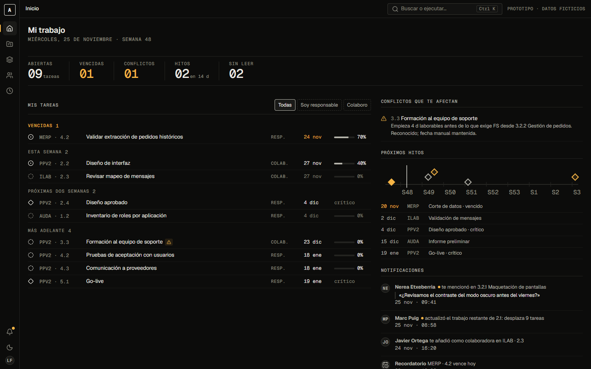 | 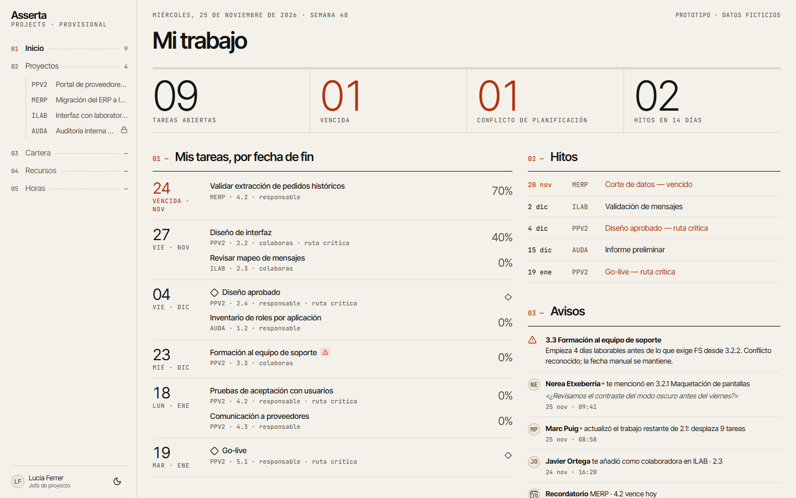 |
| Inicio · tema alterno | 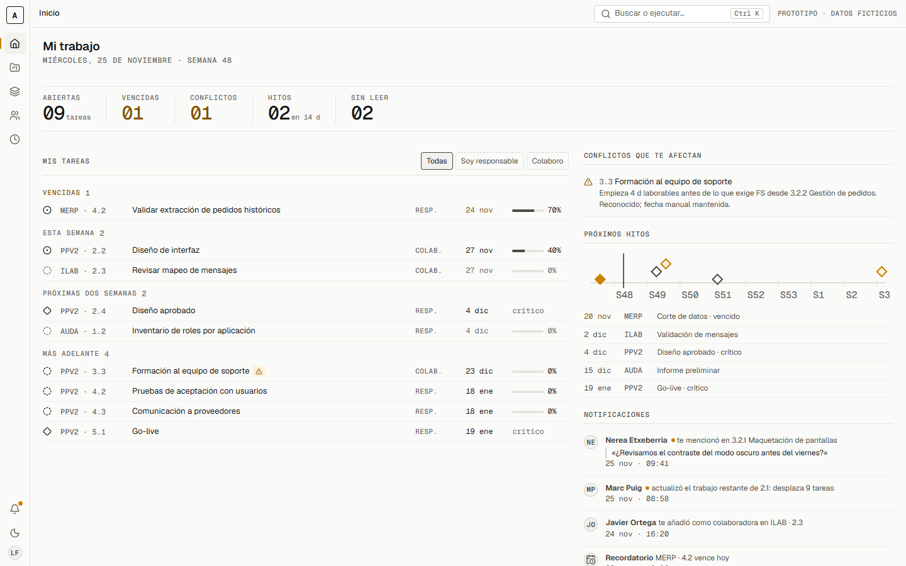 | 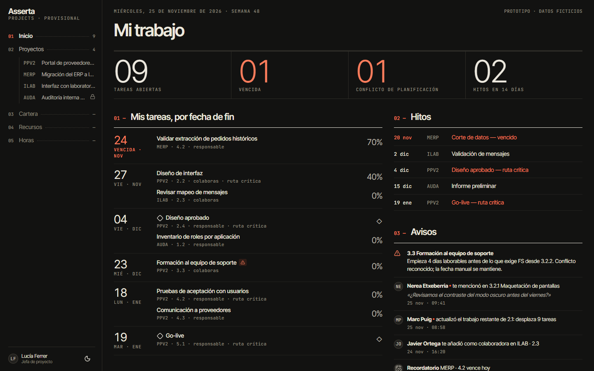 |
| Gantt · tema por defecto | 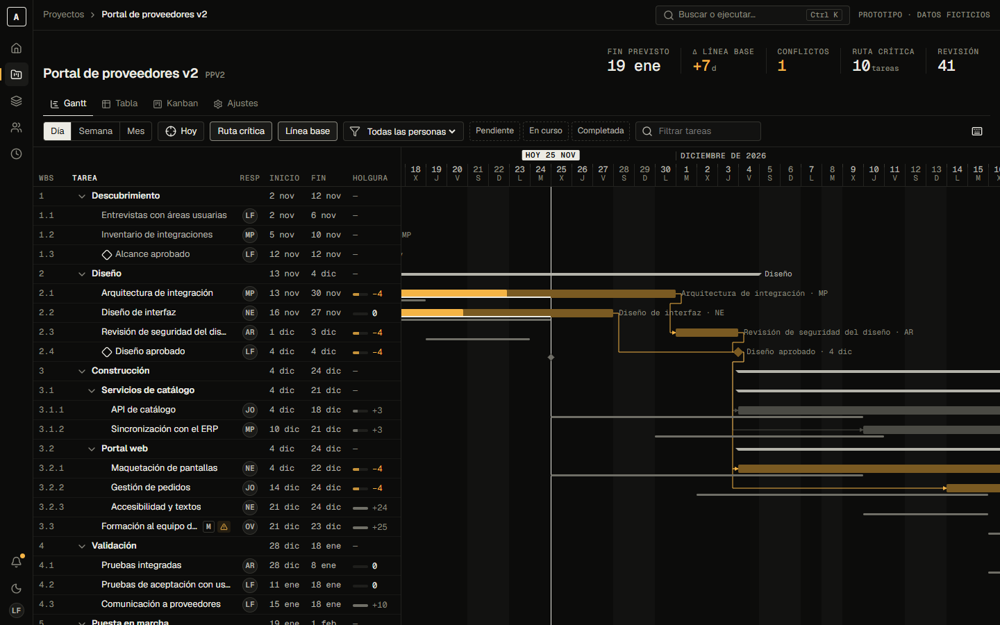 | 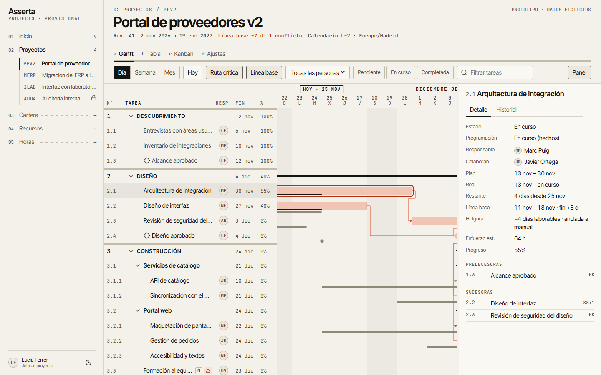 |
| Gantt · tema alterno | 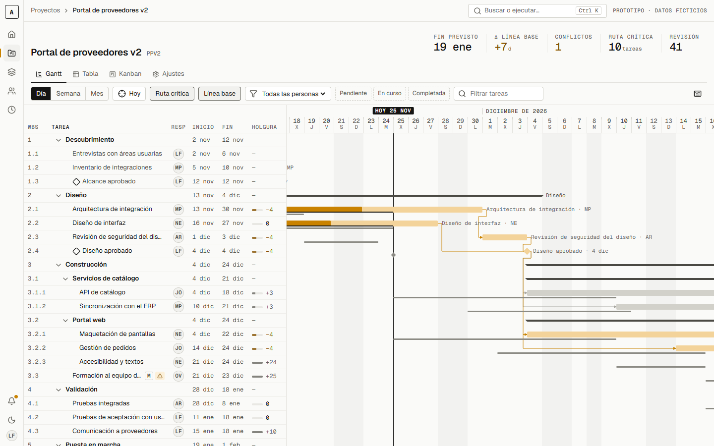 | 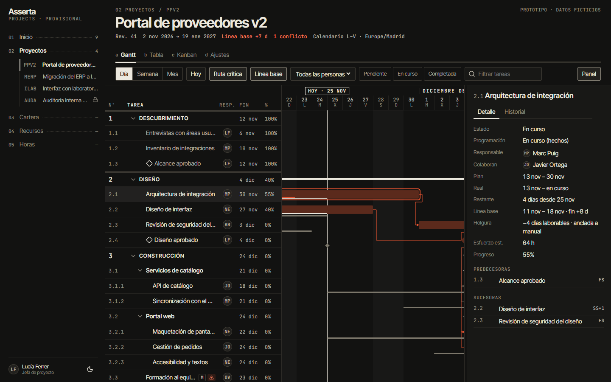 |
| Conflicto seleccionado | 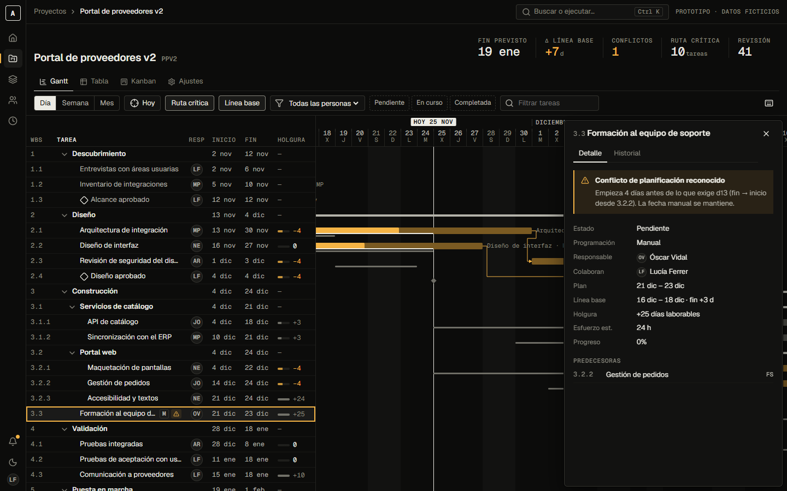 | 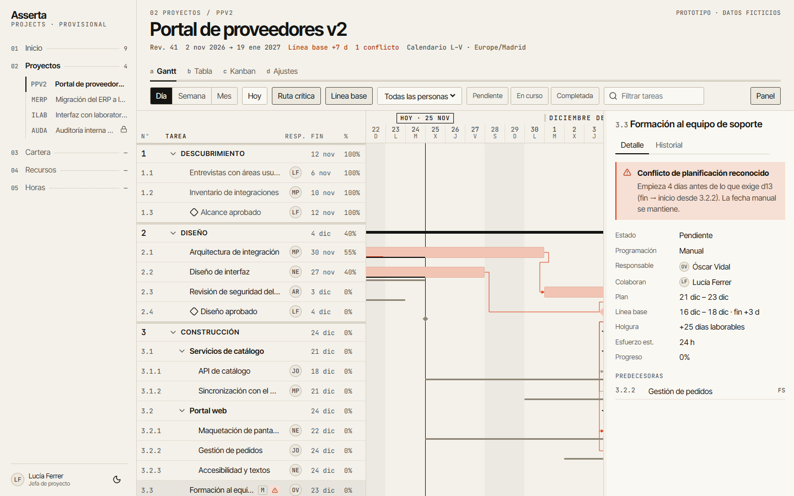 |
| Vista previa de impacto | 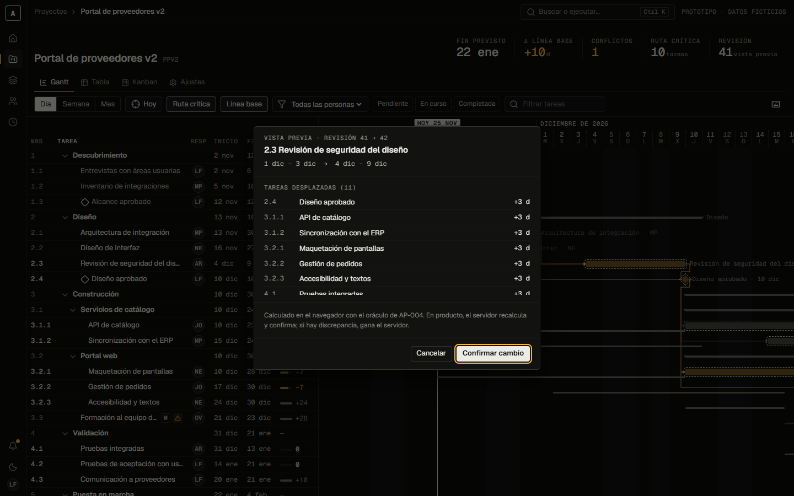 | 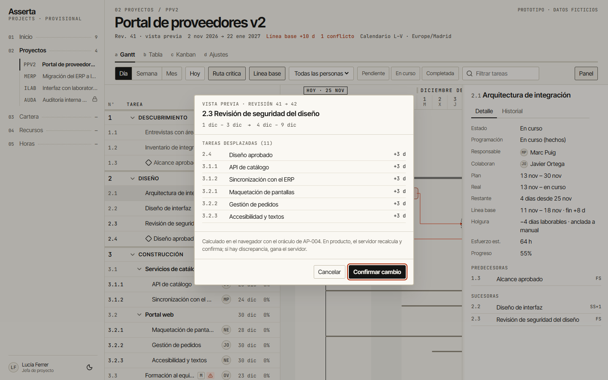 |
| 1920 px | 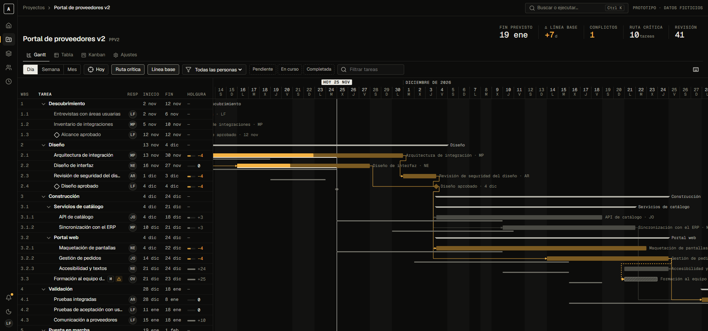 | 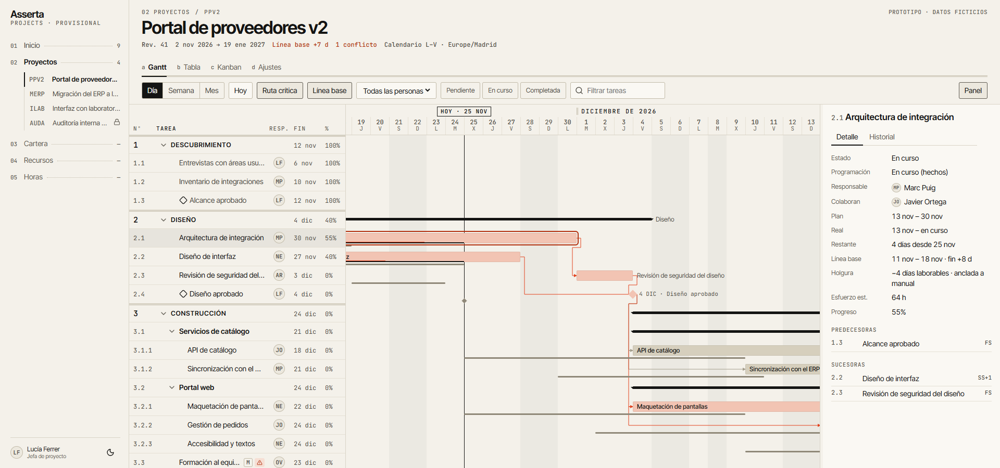 |
| Móvil 390 px (Inicio) | 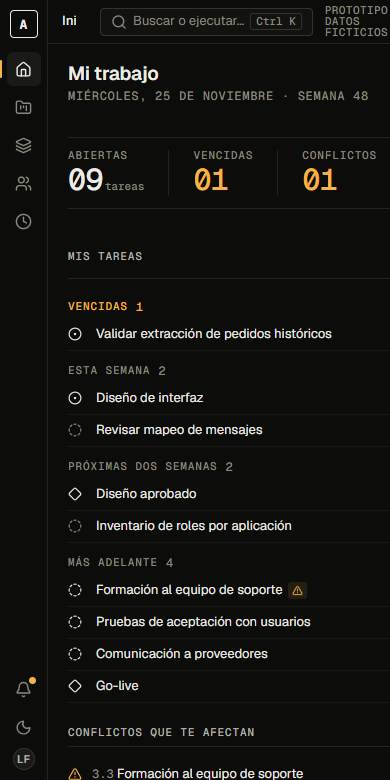 | 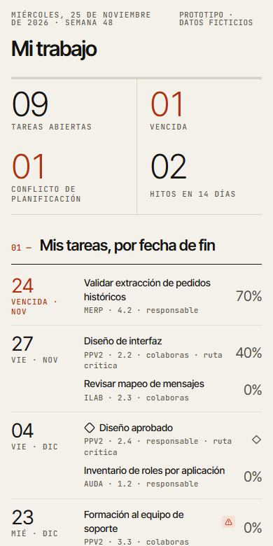 |

## 5. Evaluación con la rúbrica del plan
Valoración del agente (1–5). Es una opinión para orientar la decisión, no una medición.

| Criterio | A | B | Nota |
|---|---|---|---|
| Legibilidad con alta densidad | 4 | 4 | A cabe más; B se lee mejor a distancia y en reuniones |
| Claridad de estados, conflictos y criticidad | 4 | 5 | El bermellón sobre papel destaca más que el ámbar sobre grafito; en claro, A pierde algo de contraste en las barras críticas |
| Coherencia Inicio ↔ Gantt | 5 | 4 | B cambia más de registro entre la agenda editorial y la tabla |
| Contraste AA medido (axe) | Cumple | Cumple | §7 |
| Teclado y foco visible | 4 | 4 | Mismo modelo; B añade un separador redimensionable por teclado |
| Carácter propio (no genérico) | 4 | 5 | B es más reconocible; A recuerda a herramientas de desarrollo |
| Facilidad de aplicar la marca de Asserta | 4 | 4 | Tres capas de tokens; el cambio de marca afecta a la señal y a la tipografía |
| Coste en Tailwind + shadcn/ui | 4 | 3 | El panel acoplado y la numeración editorial de B piden más componentes propios |
| Espacio para el cronograma a 1440 px | 5 | 3 | Con el panel abierto, B deja unos 430 px de cronograma; a 1920 px desaparece el problema |

**Recomendación (a decidir por ti).** Tomar **B como base**, por identidad, legibilidad para un público mixto (dirección, jefes de proyecto, técnicos) y por arrancar en claro en un entorno corporativo. Incorporar de A:
1. un **modo compacto** de 28 px como preferencia de usuario;
2. la **franja de lecturas** en la cabecera del proyecto;
3. el **cajón flotante** en lugar del panel acoplado por debajo de 1600 px.

Si se prefiere una herramienta más «de trabajo diario» y menos editorial, A está igual de terminada.

## 6. Decisión pedida
- [ ] Dirección A
- [ ] Dirección B
- [ ] Combinación, con la lista de rasgos (p. ej. la recomendación del §5)

Después de elegir, AP-002b aplica la dirección al resto de pantallas del PRD §5 (y a los elementos de CH-12 que faltan), sin cambiar los tokens semánticos.

## 7. Comprobaciones realizadas
**Ejecutado** el 2026-11-26 con `node tools/check.mjs --dirs a,b --widths 1440,1280,1920,390`, Chrome local sin interfaz y axe-core 4.14.0 (reglas WCAG 2.0/2.1/2.2 A y AA). La salida completa está en `poc/ux-ap002a/shots-final.log`.

| Comprobación | Resultado |
|---|---|
| Capturas | 2 direcciones × 2 páginas × 2 temas × 4 anchos, más conflicto, historial, impacto, semana y 3 estados por dirección |
| Errores de JS o de consola | **0** en las 46 cargas |
| Violaciones axe | **0** en las 46 cargas, de cualquier gravedad (tampoco moderadas ni menores) |
| Interacción automatizada | Arrastre de una barra automática visible → vista previa → diálogo de impacto abierto |
| Detector de genericidad (filigrana) | Sin avisos salvo tres justificados (iniciales de avatar de 18 px junto al nombre; glifos ● ◐ ○ de salud, que son marcadores de forma y no texto) y dos falsos positivos (definición de tokens en `index.html`) |

### 7.1 Resultado de la última ejecución
46 de 46 cargas con «errores JS 0 · axe serias/críticas 0 · moderadas/menores 0». Última línea: `OK: sin errores JS ni violaciones serias/críticas`, `exit=0`.

En la iteración anterior a la entrega se encontraron y corrigieron errores reales (§8); este resultado es el de la versión final.

**No comprobado:**
- lector de pantalla real (NVDA o VoiceOver);
- Safari y Firefox;
- rendimiento con 1.000 tareas (es AP-003);
- uso real con usuarios.

El Gantt a 390 px solo se ve; editar en móvil será por formularios (PRD §5).

## 8. Problemas detectados y corregidos durante AP-002a (útiles para AP-022)
| # | Problema | Corrección |
|---|---|---|
| U-01 | El arrastre se perdía: cada render sustituía la barra con la captura del puntero | Escuchar en `window` durante el arrastre |
| U-02 | Cabecera de tabla con `role=row` fuera del `treegrid` (axe crítico) | Cabecera visual `aria-hidden` y fila de cabeceras oculta dentro del treegrid |
| U-03 | Las barras pintaban sobre la tabla fija | `isolation: isolate` en el carril del cronograma |
| U-04 | La columna `1fr` crecía con el contenido y anulaba el scroll | `minmax(0, 1fr)` en los contenedores |
| U-05 | «Hoy» quedaba bajo la tabla fija | Centrar descontando el ancho de la tabla |
| U-06 | El panel acoplado de B deja poco cronograma a 1440 px | Tabla de 5 columnas; en producto, cajón por debajo de 1600 px |
| U-07 | `[data-zoom]` capturaba también el contenedor y le ponía `aria-pressed` | Atributo propio `data-scale` |
| U-08 | Contraste insuficiente del código WBS en fila seleccionada (B claro) | Se oscurece `--tinta-3` |

## 9. Desviaciones respecto al plan AP-001-07 (y por qué)
- **B usa bermellón y no «azul profundo», y las fuentes no son Inter.** Se aplica el criterio de diseño del responsable técnico (skill filigrana): un solo color señal, nada de azul ni violeta de stock, Inter solo con motivo, y oscuro sin navy ni slate.
- **Las dos direcciones son de elaboración propia.** La skill sugiere pedir direcciones a otros motores (codex, agy), pero AGENTS.md prohíbe enviar información del proyecto a servicios no aprobados.
- **A sale de «Laboratorio / instrumento» y B de «Editorial suizo»** del repertorio de la skill, adaptadas a producto.

## 10. Dependencias del prototipo (solo `poc/ux-ap002a/`, versiones exactas publicadas hace ≥ 2 semanas)
| Paquete | Versión | Licencia | Uso |
|---|---|---|---|
| @fontsource-variable/geist · geist-mono | 5.3.0 | OFL-1.1 | Tipografía A |
| @fontsource-variable/inter-tight · jetbrains-mono | 5.3.0 | OFL-1.1 | Tipografía B |
| lucide-static | 1.71.0 | ISC | Iconos de trazo (máscara CSS) |
| playwright-core (dev) | 1.65.0 | Apache-2.0 | Capturas con el Chrome local, sin descargar navegadores |
| axe-core (dev) | 4.14.0 | MPL-2.0 | Auditoría de accesibilidad, sin modificar |

Instaladas con `--save-exact --ignore-scripts`; ninguna tiene dependencias transitivas. Sin CDN ni llamadas externas en tiempo de ejecución.
