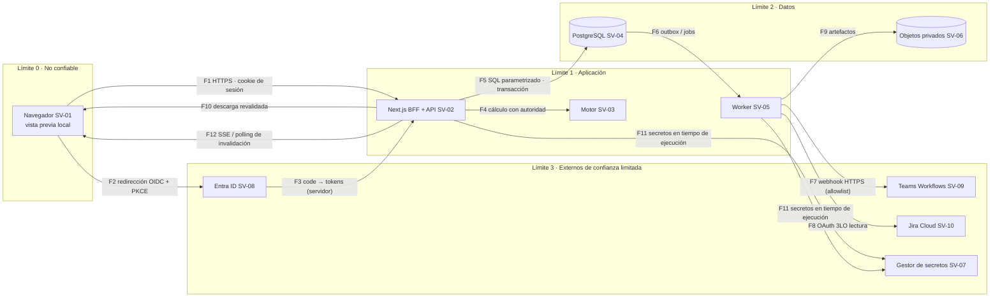

# AP-005 · 02 Flujos de datos, límites de confianza y modelo de amenazas

Estado: **propuesta técnica.** La validación corresponde a Seguridad (P-05). Los identificadores de activo (DA, SV) están en [01](AP-005-01-activos-datos.md); los de prueba (ST), en [05](AP-005-05-riesgos-pruebas.md).

## 1. Diagrama de flujo de datos

| Flujo | Datos | Protección propuesta |
|---|---|---|
| F1 | Peticiones API, datos del plan | TLS 1.2+, HSTS; cookie `__Host-` HttpOnly, Secure, SameSite=Lax; CSRF en mutaciones; CSP estricta |
| F2/F3 | Código de autorización, ID token | Authorization code + PKCE; `state`, `nonce`; validación de firma, `iss`, `aud`, `exp` y `tid`; secreto del cliente solo en el servidor |
| F4 | Entrada y salida del motor | Proceso interno; el cliente nunca aporta resultados |
| F5 | Todas las entidades | Cuenta de BD con mínimo privilegio; sin DDL en tiempo de ejecución; constraints |
| F6 | Eventos mínimos | Misma transacción que el cambio; payload sin datos sensibles |
| F7 | Tarjeta adaptativa mínima | Allowlist de egress; sin redirecciones; reintentos limitados |
| F8 | Clave, estado y resumen de incidencias | Scope `read:jira-work` (clásico) o granular equivalente; refresh token rotatorio cifrado |
| F9/F10 | Artefactos de exportación | Almacén privado; TTL de 24 h; descarga con autorización vigente; sin URLs públicas persistentes |
| F11 | Secretos | Referencias; nunca en el repositorio, los logs ni las variables de ejemplo |
| F12 | Invalidaciones (IDs) | Sin campos sensibles; reautorización en la conexión y periódicamente |

## 2. Límites de confianza
- **TB0 → TB1:** todo lo que llega del navegador se valida con Zod en el servidor. La vista previa local (D-09) es solo visual: el servidor recalcula siempre (CH-10).
- **TB1 → TB2:** solo los servicios de aplicación acceden a la BD. Toda consulta lleva el filtro de autorización (fila y campo).
- **TB1 → TB3:** salida restringida a los destinos aprobados. Las respuestas externas son **datos no confiables**: se validan, se acotan en tamaño y nunca se interpretan como instrucciones.
- **Administración:** `platform.admin` es un plano separado que **no** da acceso al contenido (D-07).

## 3. Matriz de permisos y vías de escalada

| Vía de escalada | Escenario | Control | Prueba |
|---|---|---|---|
| EP-01 Autoasignación | Un admin se concede `project.read` sobre un proyecto restringido | CHECK `principalId <> grantedBy` + servicio + auditoría (D-16) | ST-04 |
| EP-02 Pertenencia indirecta | Un admin se añade a un equipo con grants de alcance team | Segundo aprobador para cambios en la pertenencia propia (CH-08) | ST-05 |
| EP-03 Concesión transitiva | Un manager concede una capability que no tiene | Validar `capability ⊆ capacidades del que concede` | ST-06 |
| EP-04 IDOR | Adivinar un UUID de proyecto, tarea, exportación o job | Autorización por recurso en cada consulta; 404 sin oráculo de existencia | ST-01 |
| EP-05 Campos | Leer costes por la API de tareas, el historial o la exportación | Filtrado de campos en el servidor | ST-09 |
| EP-06 Revocación tardía | Un job, SSE o descarga encolados antes de revocar | Revalidar al ejecutar o servir | ST-07 |
| EP-07 Break-glass abusivo | Acceso excepcional prolongado | Caducidad (8 h por defecto, 72 h máx.), aprobador distinto, notificación, revisión (P-15) | ST-08 |
| EP-08 Último owner o admin | Eliminar al último owner o administrador | Bloqueo y sustitución obligatoria | ST-11 |
| EP-09 Rol en la UI | Saltarse un botón oculto llamando a la API | Deny-by-default en el servidor; la UI no es control | ST-01 |
| EP-10 Plantillas | Instanciar una plantilla que arrastra miembros o permisos | Las plantillas no copian miembros, grants ni secretos (RF-27) | ST-12 |

La matriz rol × acción de la v1.0 (05) sigue vigente con el modelo de alcance de CH-08. La versión normativa se fija en AP-011a.

## 4. Seguridad de Microsoft Entra ID (P-09)
- **Registro single-tenant por entorno** (dev, preprod, prod), con *redirect URI* HTTPS exacta (localhost solo en dev).
- **Assignment required** (*appRoleAssignmentRequired*): solo los usuarios o grupos asignados pueden iniciar sesión (verificado en Microsoft Learn). Se asigna a un grupo de acceso gestionado por IT.
- **Permisos mínimos:** `openid`, `profile` y, si hace falta, `email`. **Sin permisos de Graph para el login.** Sin consentimiento de usuario para otros scopes.
- **Validación de tokens:** firma (JWKS con caché y rotación), `iss` del tenant, `aud`=client_id, `exp`/`nbf`, `nonce` y `tid` igual al esperado. Identidad = `(tid, oid)`.
- **Vida de los tokens (Microsoft Learn):** ID token de 1 h por defecto; access token aleatorio entre 60 y 90 min. La app **no** usa los tokens de Entra como sesión: crea una sesión opaca propia.
- **Revocación:** la desactivación local es inmediata. La baja en Entra se detecta al revalidar la identidad (propuesta: cada 15 min y al renovar la sesión). **No consta verificado** que la evaluación continua de acceso (CAE) cubra la sesión propia de una app de terceros; no se promete revocación remota instantánea (R-03).
- **Invitados:** excluidos inicialmente por asignación y por política (P-09).
- **MFA y acceso condicional:** los gestiona IT según sus licencias; la app no los sustituye.
- **Secreto del cliente:** preferir certificado o credencial federada si la infraestructura lo permite; si no, secreto en el gestor con rotación.

## 5. Seguridad de las sesiones
| Control | Propuesta |
|---|---|
| Identificador | 256 bits aleatorios; la BD guarda solo su hash (DA-16) |
| Cookie | `__Host-sid`; HttpOnly, Secure, SameSite=Lax, Path=/; sin Domain |
| Duración | Inactividad de 30 min (propuesta) y máximo absoluto de 8 h; revalidación de identidad y roles cada 15 min |
| Rotación | Nuevo ID tras iniciar sesión y tras cambios de privilegio (fijación de sesión) |
| CSRF | SameSite=Lax + token sincronizado o cabecera personalizada comprobando `Origin` en mutaciones |
| Cierre | Cierre local + `end_session` de Entra; revocar la sesión en el servidor |
| Concurrencia | Varias sesiones permitidas, con listado y revocación por el usuario y el admin |
| SSE | Autorización al conectar y en cada evento sensible; se corta al revocar |

## 6. Integraciones
### Teams (saliente, RF-28)
- **Disparador «When a Teams webhook request is received».** Microsoft Learn documenta tres modos de autenticación: *Anyone*, *Any user in my tenant* y *Specific users in my tenant*.
  - **Propuesta:** uno de los modos de tenant, si el worker puede obtener un token de una identidad de servicio aprobada (P-22).
  - Si se usa *Anyone*, la **URL actúa como secreto** (inferencia, no documentada): se trata como DA-11, cifrada, rotable y nunca en logs.
- **Payload mínimo:** tipo de evento, identificador y enlace a la app. Sin costes, comentarios ni nombres de proyectos restringidos salvo canal con audiencia validada.
- **Egress:** allowlist de dominios de Power Automate aprobados por IT; validación DNS/IP contra SSRF; sin redirecciones; timeout; tamaño máximo.
- **Fallos:** reintento con jitter y Retry-After, DLQ y estado visible. El guardado del plan no depende de Teams (RNF-14).
- **Riesgos:** el flujo queda ligado a su propietario en Power Automate; hace falta una cuenta de servicio con co-owners (R-06).

### Jira Cloud (entrada de solo lectura, RF-29)
- **Scope mínimo:** `read:jira-work` (clásico) o `read:issue:jira` (granular), más `offline_access` para el refresh token (Atlassian).
- **Refresh tokens rotatorios:** cada uso invalida el anterior; caducan tras 90 días de inactividad; reutilización tolerada 10 min. Guardar el nuevo token **en la misma transacción** que confirma su uso, para no quedarse sin credencial (R-07).
- **Audiencia (D-17):** metadatos solo con compatibilidad declarada; si no, `linkOnly`. Purga al perder acceso o compatibilidad.
- **Datos recibidos:** validados y acotados (longitud del resumen, caracteres). El resumen se muestra como texto plano (sin HTML) contra XSS almacenado.
- **Sin escritura** en la v1; un token con más scopes de los aprobados es un fallo de configuración bloqueante.

## 7. Auditoría y trazabilidad
- **Eventos:** autenticación (éxito o fallo), cambios de plan (revisión, operaciones, conflictos reconocidos), grants y membresías, break-glass, aprobaciones de horas, cambios económicos, importaciones, exportaciones (con alcance y número de filas), configuración de conectores, purgas.
- **Campos:** actor `(tid, oid)` y ID interno, acción, objeto, UTC, `correlationId`, revisión, diff sanitizado y resultado. El rollback no deja evento de éxito (RF-14).
- **Integridad:** append-only (sin UPDATE ni DELETE para la cuenta de aplicación); purga con una cuenta separada. **Propuesta:** encadenar hashes por lote diario y exportarlos a un repositorio protegido (no se afirma inmutabilidad criptográfica hasta implementarlo y verificarlo).
- **Lectura:** `audit.read` con alcance; el historial (RF-33) filtra los campos por permiso.
- **Relojes:** NTP del host; los timestamps los genera el servidor, nunca el cliente.

## 8. STRIDE por elemento

| Elemento | S · Suplantación | T · Manipulación | R · Repudio | I · Divulgación | D · Denegación | E · Elevación |
|---|---|---|---|---|---|---|
| SV-01 Navegador | Robo de cookie → HttpOnly, `__Host-`, CSP | Vista previa manipulada → el servidor recalcula | — | XSS → CSP, escape, sin HTML en comentarios | — | Rol en la UI → EP-09 |
| F2/F3 OIDC | Code interception → PKCE; replay → nonce | Token alterado → validar firma | Login sin traza → auditar login | Token en URL o logs → solo flujo de servidor, sanear logs | Bucle de login → rate limit | Tenant ajeno → validar `tid` (ST-02) |
| SV-02 API | Sesión robada → rotación y caducidad | Mass assignment → esquemas Zod estrictos | Cambio sin actor → auditoría en la transacción | IDOR y campos → EP-04/05 | Peticiones costosas → límites, paginación, 429 | EP-01..10 |
| SV-03 Motor | — | Entrada inválida → validación completa (AP-004 §8) | `inputHash` + `engineVersion` en la revisión | — | Grafo enorme → límites (tareas, vínculos, horizonte de 10 años) | — |
| SV-04 BD | Credencial filtrada → secretos y red privada | SQLi → consultas parametrizadas; constraints | Auditoría append-only | Copias sin cifrar → cifrado en reposo | Agotamiento de conexiones → pool y timeouts | Cuenta de app con DDL → mínimo privilegio |
| SV-05 Worker | Job con identidad falsa → jobs firmados por el servidor | Payload alterado → outbox en la transacción | Job sin traza → `correlationId` | Datos en logs → sanitización | Cola atascada → leases, DLQ, alertas | Job tras revocación → EP-06 |
| SV-06 Objetos | URL adivinable → ID opaco + autorización | Artefacto alterado → hash al generarlo | Descarga sin traza → auditar | URL pública → prohibida | — | — |
| Importación | — | Fórmulas, macros, ZIP bomb → parser seguro y límites | Lote sin autor → auditoría | CSV con datos sensibles → aviso y R-08 | Fichero enorme → 10 MB / 10.000 filas | Importar grants → no permitido |
| SV-09 Teams | URL filtrada → secreto, rotación | — | Envío sin traza → estado y auditoría | Fuga en canal → payload mínimo | 429 → reintentos limitados | — |
| SV-10 Jira | Token robado → cifrado, rotación | Datos maliciosos → validar y escapar | — | Bypass de permisos de Jira → `linkOnly` | 429 → Retry-After | Scopes ampliados → bloqueo de configuración |
| SV-12 CI/CD | Acción de terceros comprometida → pin por SHA | Dependencia maliciosa → lockfile, SCA, revisión | Build sin traza → procedencia y SBOM | Secretos en CI → OIDC al cloud o secretos con alcance | — | Workflow con permisos amplios → `permissions` mínimos |
