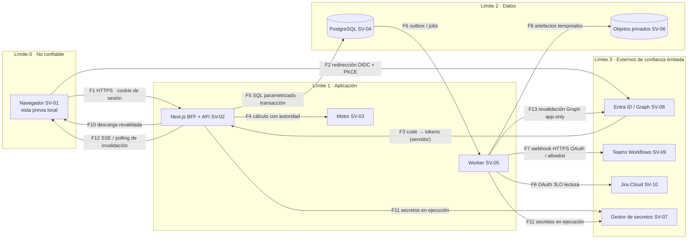

# AP-005 · 02 Flujos de datos, límites de confianza y modelo de amenazas

Estado: **propuesta técnica pendiente de aprobación.** La validación formal corresponde a Seguridad e IT (`P-05`, `P-09`, `P-22`). Los identificadores de activo (`DA`, `SV`) están en [01](AP-005-01-activos-datos.md); los de prueba (`ST`), en [05](AP-005-05-riesgos-pruebas.md).

## 1. Diagrama de flujo de datos

| Flujo | Datos | Protección propuesta |
|---|---|---|
| F1 | Peticiones API, plan, preferencias (`RF-34`) | TLS 1.2+, HSTS; cookie `__Host-sid` HttpOnly, Secure, SameSite=Lax; CSRF en mutaciones; CSP estricta |
| F2/F3 | Código de autorización, ID token | Authorization Code + PKCE; `state`, `nonce`; validación de firma JWKS, `iss`, `aud`, `exp`, `nbf` y `tid`; secreto/certificado solo en servidor |
| F4 | Entrada y salida del motor | Proceso interno determinista; el cliente nunca aporta resultados con autoridad |
| F5 | Todas las entidades, sesiones y auditoría | Cuenta de BD con mínimo privilegio; sin DDL en runtime; auditoría append-only; constraints |
| F6 | Eventos mínimos | Misma transacción que el cambio; payload sin datos sensibles ni secretos |
| F7 | Tarjeta adaptativa mínima | Preferencia por OAuth Bearer restringido al tenant; allowlist de hosts; validación DNS/IP anti-SSRF; sin redirecciones; timeouts y reintentos con backoff/jitter + DLQ |
| F8 | Clave, estado y resumen de incidencias | Scope `read:jira-work` (clásico) o `read:issue:jira` (granular) + `offline_access`; refresh token rotatorio cifrado y persistido atómicamente |
| F9/F10 | Artefactos de exportación e importación | Almacén privado; TTL 24 h; descarga revalidada; sin URLs públicas persistentes |
| F11 | Secretos y credenciales | Referencias al gestor corporativo; nunca en repo, logs ni variables de ejemplo |
| F12 | Invalidaciones (IDs) | Sin campos sensibles; reautorización en conexión y en cada evento; corte al revocar |
| F13 | Estado de cuenta (`accountEnabled`, `signInSessionsValidFromDateTime`) | Llamada servidor a servidor a Microsoft Graph con `$select` explícito y caché/revalidación ≤ 15 min (`P-33`, `P-37`) |

## 2. Límites de confianza
- **TB0 → TB1:** toda entrada del navegador se valida con esquemas Zod estrictos en servidor (rechazando campos desconocidos, especialmente en `user_preference` y `user_view_preference` de `RF-34`). La vista previa local (`D-09`) es puramente visual: el servidor recalcula siempre (`CH-10`).
- **TB1 → TB2:** solo los servicios de aplicación acceden a PostgreSQL. Toda consulta aplica autorización por fila, recurso y campo en el servidor.
- **TB1 → TB3:** egress restringido a destinos aprobados por IT. Todas las respuestas externas (Graph, Teams, Jira) se tratan como **datos no confiables**: se validan, se acotan en tamaño y nunca se interpretan como HTML ni instrucciones.
- **Separación de planos:** `platform.admin` gestiona plataforma y usuarios pero **no** concede acceso implícito al contenido de proyectos (`D-07`) **ni** a preferencias personales (`DA-18`) de otros usuarios.

## 3. Matriz de permisos y vías de escalada

| Vía de escalada | Escenario | Control | Prueba |
|---|---|---|---|
| EP-01 Autoasignación | Un admin se concede `project.read` sobre un proyecto restringido | CHECK `principalId <> grantedBy` + servicio + auditoría (`D-16`) | `ST-04` |
| EP-02 Pertenencia indirecta | Un admin se añade a un equipo con grants de alcance team | Segundo aprobador para cambios en la pertenencia propia (`CH-08`) | `ST-05` |
| EP-03 Concesión transitiva | Un manager concede una capability que no posee | Validar `capability ⊆ capacidades del concedente` | `ST-06` |
| EP-04 IDOR | Adivinar UUID de proyecto, tarea, historial, exportación o job | Autorización por recurso en cada consulta; `404` sin oráculo de existencia | `ST-01` |
| EP-05 Filtrado de campos | Leer costes por API de tareas, historial (`RF-33`), plantillas o exportación | Filtrado de campos económicos en servidor sin `financial.read` | `ST-09` |
| EP-06 Revocación tardía | Job, descarga o SSE encolados/abiertos antes de revocar acceso o dar de baja | Revalidar autorización y sesión vigente al ejecutar, servir o emitir | `ST-07` |
| EP-07 Break-glass abusivo | Acceso excepcional prolongado o autoaprobado | Caducidad (8 h defecto, 72 h máx.), aprobador distinto, notificación, revisión (`P-15`) | `ST-08` |
| EP-08 Último owner o admin | Eliminar al último owner de proyecto o último administrador | Bloqueo transaccional y sustitución obligatoria | `ST-11` |
| EP-09 Rol en la UI | Saltarse botón oculto invocando la API | Deny-by-default en servidor; la UI nunca es control de seguridad | `ST-01` |
| EP-10 Plantillas | Instanciar plantilla que arrastra miembros, permisos o costes | Las plantillas excluyen miembros, grants, costes y secretos (`RF-27`) | `ST-12` |
| EP-11 Preferencias de interfaz (`RF-34`) | Leer/escribir/resetear `user_preference` o `user_view_preference` ajenas (incluso como `platform.admin`), sondear `projectId` sin acceso o inyectar claves/columnas arbitrarias | Aislamiento estricto al propio `userId` (`ownerUserId = session.userId`, sin bypass para `platform.admin`); `404` si falta acceso al `projectId`; esquema versionado (`schemaVersion`) cerrado con allowlist de columnas/orden devolviendo `400` ante claves arbitrarias (sin KV genérico) | `ST-23` |

La matriz rol × acción se concreta normativamente en `AP-011a` con el modelo de alcance de `CH-08`.

## 4. Identidad, Microsoft Entra ID y revalidación con Graph (`P-09`, `P-33`, `P-37`)
- **Registro single-tenant por entorno** (dev, preprod, prod), con *redirect URI* HTTPS exacta (`localhost` solo en dev).
- **Assignment required** (`appRoleAssignmentRequired = true`): solo usuarios o grupos asignados en Entra ID pueden iniciar sesión (confirmado en Microsoft Learn). Se asigna a un grupo gestionado por IT; usuarios invitados excluidos por política inicial (`P-09`).
- **Permisos mínimos de inicio de sesión (`F2/F3`):** exclusivamente `openid`, `profile` y, si se requiere, `email`. **El flujo interactivo de login no solicita permisos de Microsoft Graph** ni consentimiento de usuario para scopes adicionales.
- **Validación estricta de tokens OIDC:** firma (JWKS con caché y rotación), `iss` del tenant corporativo, `aud = client_id`, `exp`/`nbf`, `nonce` de un solo uso y `tid` exacto. Identidad primaria inmutable = `(tid, oid)`; nunca email/UPN.
- **No dependencia de CAE para sesiones propias de la aplicación:** según Microsoft Learn, Continuous Access Evaluation (CAE) opera mediante tokens Bearer con capacidad `cp1` y desafíos `401 WWW-Authenticate` entre clientes y APIs compatibles con CAE; **no revoca automáticamente cookies de sesión opacas** gestionadas por una aplicación web de terceros. Por ello, la seguridad de sesión **NO confía en CAE** y exige controles propios de servidor (§5 y revalidación periódica).
- **Bajas corporativas, cuentas deshabilitadas y cambios de permisos:**
  - La desactivación local de un usuario o la modificación/revocación de sus grants o membresías locales **invalida de inmediato** sus sesiones afectadas en PostgreSQL (sin esperar a Entra/Graph).
  - Para reflejar bajas corporativas en Entra ID (`accountEnabled = false`, usuario eliminado o sesiones revocadas mediante `signInSessionsValidFromDateTime`, así como cambios de asignación/membresía si se sincronizan), se propone un mecanismo servidor-a-servidor con **objetivo máximo provisional de detección de 15 minutos** (`P-33`, pendiente de IT/Seguridad).
- **Permisos de Microsoft Graph, limitaciones y comportamiento ante indisponibilidad:**
  - **Consulta mínima:** `GET https://graph.microsoft.com/v1.0/users/{oid}?$select=id,accountEnabled,signInSessionsValidFromDateTime` (el parámetro `$select` es obligatorio porque Microsoft Graph no devuelve `accountEnabled` ni `signInSessionsValidFromDateTime` por defecto).
  - **Permiso mínimo real de aplicación (verificado en Microsoft Learn):** aunque `User.ReadBasic.All` admite tipo *Application* para perfil básico, la lectura fiable de `signInSessionsValidFromDateTime` (y propiedades extendidas de estado de sesión) requiere **`User.Read.All` (Application)** — menos privilegiado que `Directory.Read.All`, pero exige **consentimiento de administrador** de IT y otorga lectura de perfiles del directorio. Si IT no aprueba `User.Read.All`, deberán aprobar en `P-33` una alternativa equivalente (p. ej. integración con flujo de bajas de IT/SCIM hacia endpoint interno de revocación o re-autenticación silenciosa acotada). Cualquier ampliación adicional de scopes de Graph requiere ADR y consentimiento expreso de IT.
  - **Limitaciones operativas de Graph:**
    - *Throttling* (`429 Too Many Requests` + cabecera `Retry-After`): se mitiga consultando solo usuarios con sesión activa, con `$select` mínimo, caché de verificación por usuario (ventana ≤ 15 min) y respeto estricto de `Retry-After`.
    - *Sin push instantáneo en el diseño base:* Graph no notifica cambios en tiempo real salvo configurando *change notifications* (`/subscriptions` sobre `/users`), sujetas a cuotas (100 suscripciones/app/tenant, 1.000/tenant), renovación periódica y exposición de un webhook HTTPS con validación en ≤ 10 s (fuera de v1 salvo aprobación de IT).
  - **Comportamiento explícito ante indisponibilidad de Microsoft Graph (`P-37`, pendiente de Seguridad/IT):**
    - La desactivación local y revocación manual de sesiones siguen funcionando **siempre de forma inmediata** (sin dependencia de Graph).
    - Ante fallo prolongado, timeout o `5xx`/`429` sostenido de Graph durante la revalidación de 15 min, Seguridad e IT deben aprobar una de las dos políticas:
      - **Opción A (propuesta provisional para v1) — Fail-open acotado con ventana máxima y alerta:** permitir continuidad únicamente dentro de una ventana máxima de gracia (p. ej. 30 min desde la última verificación válida o hasta el vencimiento por inactividad de 30 min, lo que ocurra antes), disparando alerta prioritaria a operaciones/Seguridad y pasando a **fail-closed** si la indisponibilidad supera la ventana.
      - **Opción B — Fail-closed estricto:** denegar peticiones en cuanto venza el intervalo de 15 min sin confirmación de Graph (prioriza confidencialidad frente a disponibilidad).
- **MFA, acceso condicional y credencial de aplicación:** MFA y acceso condicional los aplica IT en Entra ID conforme a sus licencias (`op.acc.6`). Para el cliente confidencial se prioriza certificado o credencial federada; si se usa secreto de cliente, reside en `SV-07` con rotación planificada.

## 5. Seguridad de las sesiones (`P-32`)
La aplicación **nunca** utiliza el ID token ni el access token de Entra ID (ni ningún JWT autocontenido) como sesión web.

| Control | Especificación propuesta (pendiente de aprobación IT/Seguridad) |
|---|---|
| Tipo de sesión | **Sesión opaca revocable desde servidor**, almacenada en PostgreSQL (`DA-16`) como hash criptográfico (SHA-256) de un identificador aleatorio de 256 bits (CSPRNG) |
| Cookie | `__Host-sid`; `HttpOnly`, `Secure`, `SameSite=Lax`, `Path=/`; sin atributo `Domain` |
| Duración provisional (`P-32`) | **Máximo absoluto: 8 horas**; **inactividad máxima: 30 minutos** |
| Detección de bajas y cambios (`P-33`) | **Objetivo máximo: 15 minutos** para detectar `accountEnabled=false` o `signInSessionsValidFromDateTime > session.createdAt`; comprobación inmediata en servidor de estado local y versión de permisos/membresías |
| Revocación masiva por usuario | Capacidad explícita (`revokeAllUserSessions(userId)`) para **invalidar todas las sesiones activas de un usuario** ante baja, cuenta deshabilitada, compromiso sospechado, cambio de permisos/membresías o acción administrativa; auditoría obligatoria en `DA-10` |
| Rotación | Nuevo ID de sesión tras autenticación exitosa y ante cambios de privilegio (mitiga fijación de sesión) |
| Protección CSRF | `SameSite=Lax` + token sincronizado o cabecera personalizada con validación estricta de `Origin`/`Referer` en todas las mutaciones |
| Cierre de sesión | Revocación inmediata en PostgreSQL + borrado de cookie + redirección a `end_session` de Entra ID |
| Concurrencia | Múltiples sesiones permitidas con listado de sesiones activas y revocación individual o total por el propio usuario y por `platform.admin` |
| SSE / descargas / jobs | Verificación de sesión vigente y autorización al conectar/encolar y antes de emitir eventos sensibles o servir descargas; corte inmediato al revocar |

## 6. Integraciones

### Teams Workflows (notificaciones salientes, `RF-28`, `P-22`)
- **Modos de autenticación del disparador y distinción SAS vs OAuth (verificado en Microsoft Learn):**
  - `Anyone`: genera una URL que contiene una **firma SAS** embebida (`&sig=`); cualquiera en posesión de la URL puede invocar el flujo sin autenticación adicional (y no debe enviarse cabecera `Authorization`).
  - `Any user in my tenant` y `Specific users in my tenant`: **no llevan firma SAS (`&sig=`) en la URL**; exigen autenticación mediante **`Authorization: Bearer <token>`** de Microsoft Entra ID (validando `iss`, `tid`, `aud = https://service.flow.microsoft.com/` con barra final y, en *Specific users*, el identificador autorizado).
  - **Prohibición por defecto de `Anyone`:** los endpoints anónimos (`Anyone`) quedan **prohibidos por defecto** y solo podrían autorizarse mediante **aceptación formal y explícita del riesgo por parte de IT y Seguridad** (`P-22`, `R-06`), aplicando en tal caso cifrado de URL como secreto crítico (`DA-11`), rotación periódica y validación secundaria de cabecera secreta dentro del flujo.
- **Verificación de identidad de aplicación (Service Principal / Client Credentials):**
  - En el disparador HTTP general de Power Automate (*«When an HTTP request is received»*), Microsoft Learn documenta el uso de Service Principal con *Client Credentials* solicitando `scope: https://service.flow.microsoft.com//.default` (`aud: https://service.flow.microsoft.com/`) e indicando el **Object ID del Service Principal** (no el Client ID) en *Allowed users*.
  - **Matiz y limitación verificada:** en el disparador específico del conector de Teams (*«When a Teams webhook request is received»*), existen limitaciones operativas conocidas con tokens *app-only* (Client Credentials) frente a tokens de usuario/UPN cuando se configura *Specific users in my tenant* (errores `401`/`403` por validación orientada a usuario). Por ello, antes de `AP-046` se ejecutará una **prueba controlada en el tenant corporativo (`P-22`)** priorizando: (1) disparador restringido al tenant con Service Principal si el tenant lo admite, o (2) flujo Power Automate con disparador HTTP autenticado al tenant (`Specific users` con Object ID del SP) + acción oficial de publicación en canal de Teams.
- **Propiedad y rotación:** los flujos deben crearse bajo una **cuenta de servicio o identidad corporativa con co-propietarios** (evitando dependencia de un empleado individual, `R-06`). Se establece procedimiento de rotación de credenciales OAuth (preferiblemente certificado/credencial federada) y de URL del webhook.
- **Protección SSRF y egress:**
  - *Allowlist* estricta de hosts aprobados por IT para Power Automate / Logic Apps del tenant (p. ej. dominios específicos de `*.logic.azure.com` / `*.environment.api.powerplatform.com` de la región UE del tenant).
  - Resolución DNS y validación de IP destino bloqueando rangos privados, loopback, link-local y metadatos cloud (`10.0.0.0/8`, `172.16.0.0/12`, `192.168.0.0/16`, `127.0.0.0/8`, `169.254.0.0/16`, `::1`, `fc00::/7`).
  - **Sin redirecciones HTTP** (`redirect: 'error'`), timeouts estrictos de conexión/lectura y límite de tamaño de respuesta.
- **Resiliencia, idempotencia y auditoría:** clave de idempotencia (`eventId`) por entrega, reintentos acotados con *backoff* exponencial + *jitter* respetando `Retry-After`, **DLQ** con estado visible y alertas. El guardado del plan nunca depende de Teams (`RNF-14`). Todo cambio de configuración de webhook y todo fallo terminal queda auditado en `DA-10`.
- **Prevención de filtraciones entre proyectos:** payload mínimo (tipo de evento, ID interno y enlace profundo a la app; **nunca** costes, texto de comentarios ni datos sensibles). Para proyectos `visibility=restricted`, no se envían nombres/títulos ni notificaciones a canales compartidos sin validación explícita de compatibilidad de audiencia del canal.

### Jira Cloud (entrada de solo lectura, `RF-29`, `P-21`)
- **Scope mínimo:** `read:jira-work` (clásico) o `read:issue:jira` (granular) + `offline_access` (Atlassian Developer).
- **Refresh tokens rotatorios:** cada uso invalida el anterior; caducan tras 90 días de inactividad; ventana de reutilización tolerada de 10 min. El nuevo refresh token debe persistirse **atómicamente en la misma transacción** que confirma su rotación (`R-07`).
- **Audiencia (`D-17`):** metadatos almacenados solo con compatibilidad declarada; en caso contrario, `linkOnly`. Purga inmediata al perder acceso o compatibilidad.
- **Datos recibidos:** validados, acotados en longitud y mostrados como texto plano (sin HTML) contra XSS almacenado (`ST-17`).
- **Sin escritura en v1:** detectar scopes de escritura en el token constituye un error de configuración bloqueante (`ST-16`).

## 7. Auditoría de seguridad vs historial funcional (`RF-33`, `AP-012`)

Se separan explícitamente dos vistas/propósitos de trazabilidad para evitar tanto fugas de información como inconsistencias:

| Dimensión | Auditoría de seguridad (`DA-10`) | Historial funcional (`RF-33`) |
|---|---|---|
| Propósito | Seguridad, operación, compliance ENS (`op.exp.8`), investigación forense | Trazabilidad de negocio de cambios en proyectos y tareas |
| Acceso requerido | `audit.read` (con alcance; nunca expuesto por `project.read`) | `project.read` sobre el proyecto correspondiente |
| Filtrado económico | Campos económicos visibles solo con `audit.read` + política definida; sin secretos | **Campos económicos omitidos en servidor** si el usuario carece de `financial.read` (`ST-09`) |
| Eventos cubiertos | Logins (éxito/fallo), revocación de sesiones, bajas detectadas, grants/membresías, break-glass, cambios económicos, exportaciones masivas (alcance y nº filas), conectores, purgas y sanitizaciones | Creación/edición/eliminación de tareas, fechas, dependencias, revisiones del plan, estados, líneas base y aprobaciones funcionales |
| Consistencia | Pueden compartir almacenamiento transaccional subyacente o tablas/proyecciones diferenciadas escritas **en la misma transacción** del cambio (sin duplicidad inconsistente; el rollback no deja evento de éxito, `RF-14`) | Misma transacción que la mutación del plan |

- **Inmutabilidad desde la aplicación (append-only):** la cuenta de PostgreSQL usada por la aplicación y el worker solo posee permisos `INSERT` y `SELECT` sobre la auditoría de seguridad (**sin `UPDATE` ni `DELETE`**; verificado por `ST-13`). Las purgas por retención requieren una cuenta administrativa separada y aprobación formal de Seguridad.
- **Campos mínimos obligatorios en `DA-10`:** actor `(tid, oid)` + ID interno (o actor de sistema), acción, fecha/hora **UTC generada en servidor** (NTP del host, nunca confiada al cliente), recurso (tipo, ID y ámbito), resultado (`success` / `denied` / `error`) e identificador de correlación (`correlationId`), además de `revision` y diff sanitizado cuando proceda.
- **Exclusiones estrictas:** se prohíbe registrar contraseñas, secretos, tokens OAuth, hashes/cookies de sesión, URLs firmadas SAS, cuerpo libre de comentarios o datos personales innecesarios.
- **Refuerzo propuesto (`P-34`):** encadenado criptográfico de hashes por lote diario con exportación a repositorio protegido externo (no se afirma inmutabilidad criptográfica hasta implementarlo y verificarlo).

## 8. STRIDE por elemento

| Elemento | S · Suplantación | T · Manipulación | R · Repudio | I · Divulgación | D · Denegación | E · Elevación |
|---|---|---|---|---|---|---|
| SV-01 Navegador | Robo de cookie → `__Host-`, HttpOnly, Secure, CSP | Vista previa manipulada → servidor recalcula siempre (`CH-10`) | — | XSS → CSP estricta, escape, sin HTML en comentarios | — | Rol en UI → `EP-09` |
| F2/F3/F13 OIDC & Graph | Code interception → PKCE; replay → `nonce`; no confiar en CAE | Token alterado → validación JWKS, `iss`, `aud`, `tid` | Login/fallo sin traza → auditar en `DA-10` | Token en URL/logs → solo servidor, logs sanitizados | Caída/429 de Graph → caché ≤ 15 min, `Retry-After`, política `P-37` | Tenant ajeno o baja → validar `tid` (`ST-02`) + revalidación ≤ 15 min |
| SV-02 API | Sesión robada → rotación, caducidad 8 h / 30 min, revocación total | Mass assignment / KV arbitrario → Zod estricto + `schemaVersion` (`EP-11`) | Cambio sin actor → auditoría en transacción | IDOR, campos económicos, preferencias ajenas → `EP-04/05/11` | Peticiones costosas → límites, paginación, `429` | `EP-01..11` |
| SV-03 Motor | — | Entrada inválida → validación completa (`AP-004 §8`) | `inputHash` + `engineVersion` en revisión | — | Grafo masivo → límites de tareas, vínculos y horizonte | — |
| SV-04 PostgreSQL | Credencial filtrada → gestor de secretos y red privada | SQLi → SQL parametrizado + constraints | Auditoría append-only sin UPDATE/DELETE | Backups sin cifrar → cifrado + credenciales separadas | Agotamiento de conexiones → pool y timeouts | Cuenta de app con DDL → mínimo privilegio |
| SV-05 Worker | Job falsificado → outbox firmado/generado por servidor | Payload alterado → outbox en transacción | Job sin traza → `correlationId` | Datos en logs → sanitización | Cola atascada → leases, DLQ, alertas | Job tras revocación → `EP-06` |
| SV-06 Objetos | URL adivinable → ID opaco + autorización | Artefacto alterado → hash al generar | Descarga sin traza → auditar | URL pública → prohibida; TTL 24 h | — | — |
| Importación | — | Fórmulas, macros, ZIP bomb → parser seguro y límites | Lote sin autor → auditoría | CSV con datos sensibles → aviso y procedimiento `R-08` | Fichero enorme → 10 MB / 10.000 filas | Importar grants → prohibido |
| SV-09 Teams | Invocación no autorizada → OAuth tenant-restricted; `Anyone` prohibido por defecto | SSRF / redirección → allowlist + validación DNS/IP + sin redirecciones | Envío sin traza → estado, DLQ y auditoría | Fuga entre proyectos → payload mínimo + audiencia de canal | `429` → backoff + jitter + `Retry-After` + DLQ | — |
| SV-10 Jira | Token robado → cifrado en `SV-07`, rotación atómica | Datos maliciosos → validar y mostrar en texto plano | — | Bypass permisos Jira → `linkOnly` (`D-17`) | `429` → `Retry-After` | Scopes de escritura → bloqueo (`ST-16`) |
| SV-12 CI/CD | Acción comprometida → pin por SHA | Dependencia maliciosa → lockfile, SCA, revisión | Build sin traza → procedencia y SBOM | Secretos en CI → secret scanning y secretos con alcance | — | Workflow sobreprivilegiado → `permissions` mínimos |
